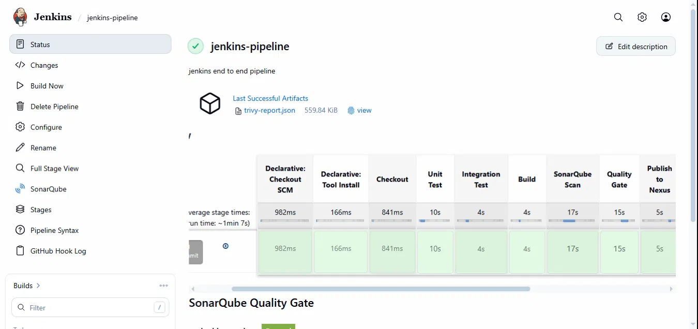
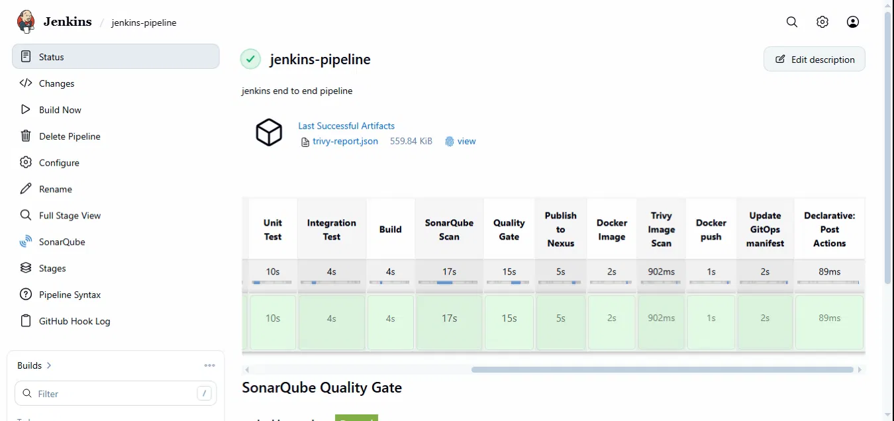
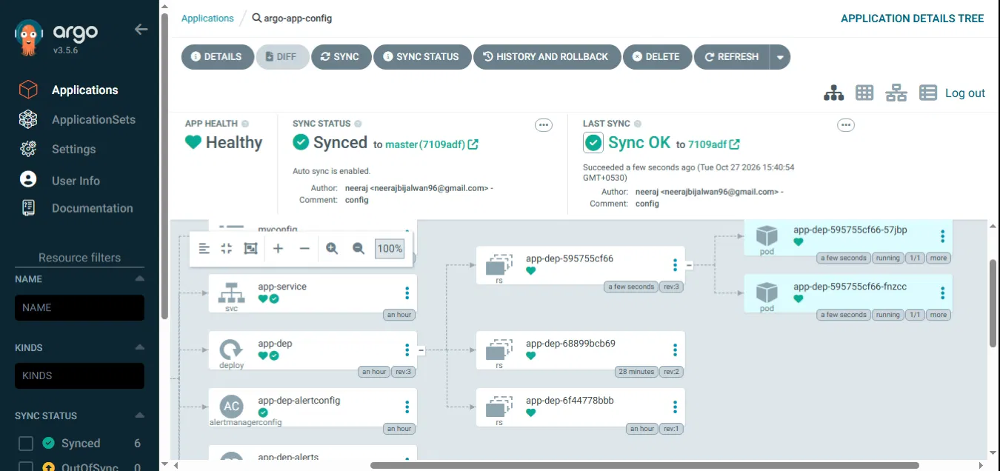
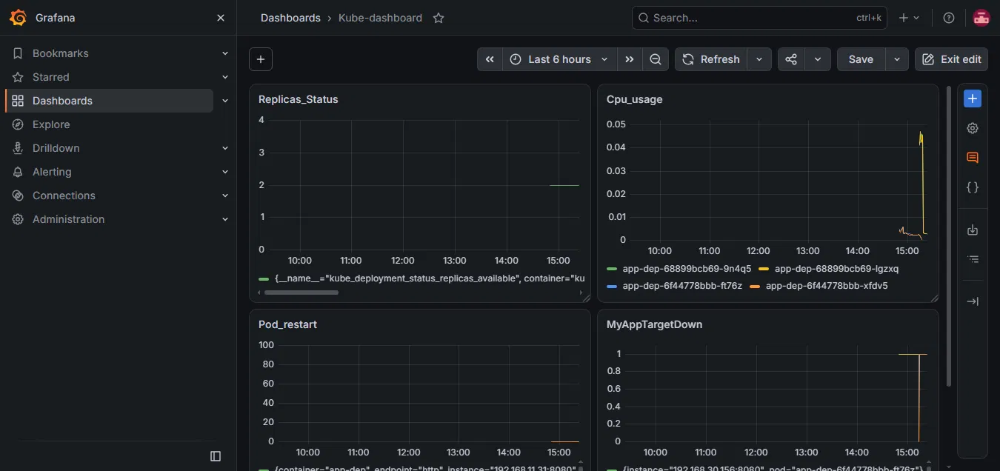
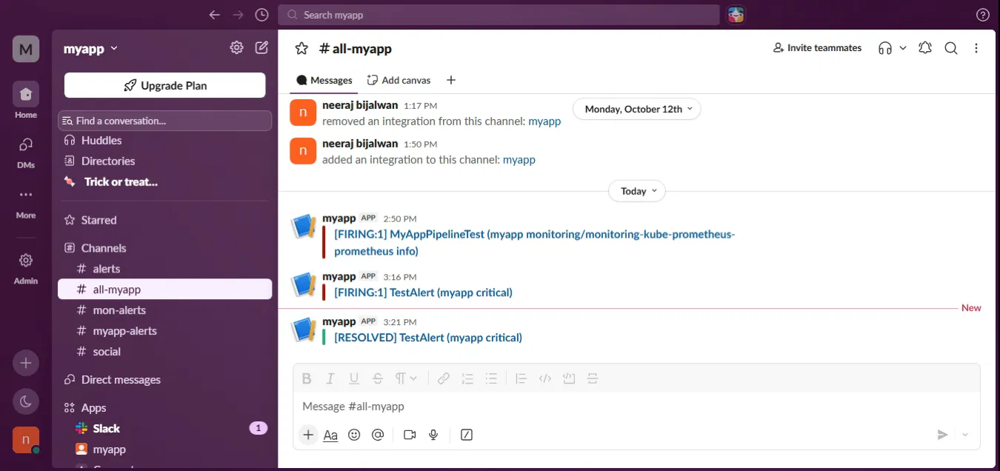

# Jenkins End-to-End CI/CD Pipeline

Jenkins builds, tests and scans the app, pushes the image to Docker Hub, and commits the new tag to `k8s/`. Argo CD syncs it to the cluster, and Prometheus, Grafana and Alertmanager handle monitoring and alerts.

## Jenkins pipeline

## GitOps deployment (Argo CD)

Argo CD watches the `k8s/` folder and syncs the app automatically. The application is Healthy and Synced, with the newest ReplicaSet running.

## Monitoring

Prometheus scrapes both app pods through the ServiceMonitor.

Grafana dashboard for replicas, CPU usage, pod restarts and target status.

## Alerting

Alertmanager sends firing and resolved alerts to Slack.

